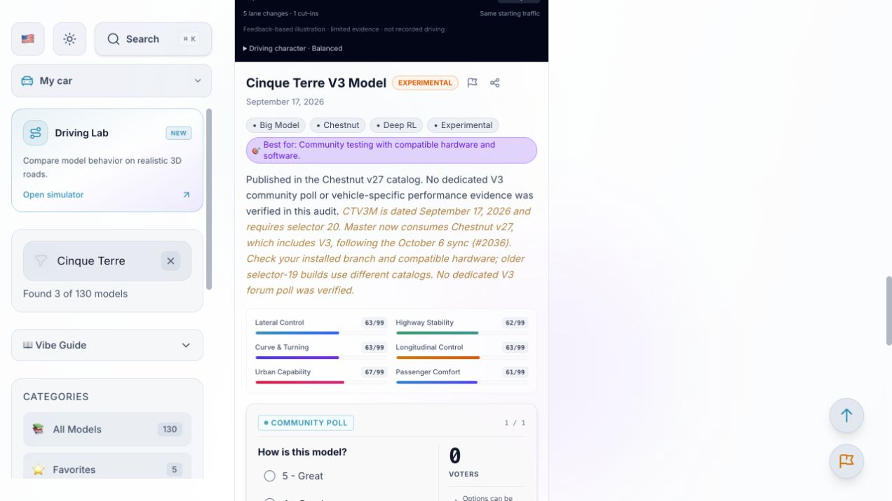

# Friday accuracy audit — October 9, 2026

Status: **deployed and verified October 10, 2026**, after the user approved this October 9 batch. The isolated release contains 28 source/test files. Production now serves `sunnylink-wiki-service-refresh-20261009-a29313`. See deployment verification below.

Review the [isolated patch](2026-10-09.patch), [source ledger and file hashes](2026-10-09.sources.json), and [validation output](2026-10-09.validation.txt). The patch compares against the working files captured at the start of this run, including existing unpublished user work. It excludes that prior work and was checked with `git apply --check` against the captured baseline. At audit preparation, no commit, push, merge, publication, or deployment had occurred. The subsequent approved deployment is recorded below.

## Prepared corrections

| Area | Previous claim or behavior | Prepared correction and evidence |
| --- | --- | --- |
| Model compatibility | Master uses selector 19 / Chestnut v25; selector 20 is still only a proposal. | Master moved to selector 20, Chestnut v27 and Qualcomm v23 in the October 6 [merged sync #2036](https://github.com/sunnypilot/sunnypilot/pull/2036). The inspected [selector definition](https://github.com/sunnypilot/sunnypilot/blob/3323aafb5422cee72653206dc83a56e66c61799d/openpilot/sunnypilot/models/helpers.py) and [catalog fetcher](https://github.com/sunnypilot/sunnypilot/blob/3323aafb5422cee72653206dc83a56e66c61799d/openpilot/sunnypilot/models/fetcher.py) confirm those values. |
| Cinque Terre V2/V3 | V3 availability in master is not established; V2 note names the old catalog. | Master's consumed Chestnut v27 catalog includes V3. Its [default big model definition](https://github.com/sunnypilot/sunnypilot/blob/3323aafb5422cee72653206dc83a56e66c61799d/openpilot/sunnypilot/models/model_name.py) names Cinque Terre Model v2. Notes preserve hardware requirements and distinguish current development builds from the latest tagged release. No dedicated V3 forum poll was verified. |
| Published catalogs versus adoption | Open PR #2015 is used as evidence that selector 20 has not landed. | #2015 remains open, but selector 20 already arrived through #2036. Qualcomm v24 is published in the [model repository](https://github.com/sunnypilot/sunnypilot-models/compare/9850fb07544b3c1f8c21b793c454e606dbb7fdca...1ea3e6d2ae0040e35a5729604e7d84b756e31e83); adoption remains an [open proposal #2044](https://github.com/sunnypilot/sunnypilot/pull/2044). |
| Model library wording | Settings advertise 66+ available models. | The wiki documents 130 models; availability on a device depends on hardware and branch. No new model names were added. |
| RDF Model | Weighted score 76, 44 votes. | [Overall forum poll](https://community.sunnypilot.ai/t/6569): 45 voters, Great/Good/OK/Bad-Poor counts 14/19/11/1. Apportioned percentages 31/42/25/2 produce weighted score 75. |
| RDF Model v2 | Local catalog score 52, 15 votes; prior poll snapshot already had 18 voters. | [Overall forum poll](https://community.sunnypilot.ai/t/6763): 19 voters, counts 5/7/1/6. Percentages 26/37/5/32 produce weighted score 56. |
| Unrated models | Missing evidence creates a default ten-voter distribution; rounding creates eleven option votes. | Remove fabricated fallback votes. Accept an explicit baseline only with a recorded positive vote count and valid sentiment distribution; allocate exactly that count. Keep actual forum and wiki votes. Hide card rating badges when there are no recorded overall ratings. |

The live `/models` page was also inspected through its rendered browser content. Its V2/V3 notes still name selector 19 and Chestnut v25. The V3 card displays 81% and 11 votes while its poll reports ten voters, corroborating the fallback/rounding bug. Server-rendered HTML alone did not expose the client-rendered notes, so it was not used to conclude those notes were absent.

Scores use the site's existing Great=100, Good=75, OK=50, Bad/Poor=0 convention. They are weighted ratings, not the percentage of users endorsing a model. Only the two changed poll snapshots were replaced; the other 48 were preserved.

## Affected content and code

- Model notes and recommendations: `data/models.json` and all five localized model files; `/models`.
- Driving Models guide: `data/features.json` and all five localized feature files; `/features`.
- Refresh Models, Driving Model and Model Library settings: `data/toggles.json` and all five localized setting files; settings pages and related setup content.
- Poll snapshots: `data/discourse_polls.json`.
- Vote calculation and display: `lib/modelVotes.ts`, `components/ModelLibrary.tsx`.
- English and German, Spanish, French, Korean and Chinese runtime dictionaries: eight new content keys in each `locales/*.json`, with authored translations and aligned structures/identifiers.
- Regression coverage: `tests/model-votes.test.ts`, using temporary fixtures rather than production votes.

Existing unpublished changes to car data, UI, search, deployment configuration and other files were retained. This audit adds no car compatibility claim and does not modify supported-car data.

## Coverage and unresolved findings

Compared sources since the successful October 3 scan with both deployed content and the run-start local files. The source ledger records URLs, fetch times, HTTP results and response hashes for 144 requests (141 successful responses; three initial forum timeouts resolved through successful retries). Coverage includes release and recent commit/PR/issue indexes, relevant settings and model code, official docs and documentation repository, forum announcement/documentation/model indexes, selected recent vehicle and troubleshooting discussions, and all 50 stored model poll topics. This is targeted current coverage, not an exhaustive historical review.

- Latest tagged release remains [v2026.002.002](https://github.com/sunnypilot/sunnypilot/releases/tag/v2026.002.002). Master sync and subsequent dev/staging builds do not establish a new stable release. Development heads and source snapshots are recorded in the ledger.
- Scanner inspected Chestnut v27, Qualcomm v24 and USB GPU v22: 99 remote references, all already represented among 130 local models. The model repository comparison contains 26 commits and artifact/catalog updates. PR #2044's title does not establish a new named driving model.
- The official [documentation repository](https://github.com/sunnypilot/user-docs) remains at `c34b63208cdb7bcbef389cf90b3c15e38221a8bc` (May 6). The docs site's current forum documentation destination was checked too.
- The [upstream supported-car table](https://github.com/commaai/openpilot/blob/master/docs/CARS.md) still matches the local 334 vehicle identifiers and year ranges. Relevant sunnypilot/opendbc changes and [ccNC proposal #1306](https://github.com/sunnypilot/sunnypilot/pull/1306) were reviewed; experimental vehicle/branch reports do not warrant new stable support claims.
- [Audio report #7384](https://community.sunnypilot.ai/t/7384), [#7389](https://community.sunnypilot.ai/t/7389), [#7230](https://community.sunnypilot.ai/t/7230), and recent [general discussion #22](https://community.sunnypilot.ai/t/22) still show ongoing, setup-specific reports. No universal released fix was verified. Upstream AGNOS 19.9 differs from inspected sunnypilot master 19.7; upstream adoption cannot be assumed. No manual permission workaround was added as a recommendation.
- [#2035](https://github.com/sunnypilot/sunnypilot/pull/2035), [#2023](https://github.com/sunnypilot/sunnypilot/pull/2023), [#1999](https://github.com/sunnypilot/sunnypilot/pull/1999), [#2042](https://github.com/sunnypilot/sunnypilot/pull/2042), [#2043](https://github.com/sunnypilot/sunnypilot/pull/2043), [#2046](https://github.com/sunnypilot/sunnypilot/pull/2046) and [#2047](https://github.com/sunnypilot/sunnypilot/pull/2047) remain proposals. Stop-sign/traffic-light [#2045](https://github.com/sunnypilot/sunnypilot/pull/2045) was closed without merging; it is not documented as released.
- GitHub Discussions is disabled for `sunnypilot/sunnypilot`. Live Discord feedback was unavailable. The available 115-file Discord archive ends April 5, 2026; it was not treated as current sentiment. No V3 rating, poll result or performance recommendation was invented.

## Validation and deployment readiness

| Check | Result |
| --- | --- |
| `npm run i18n:check` | Passed: 3,751 keys per locale; placeholders, canonical values and data structures align across all five translations. |
| Relevant model, translation and vehicle tests | 12 passed, including the new evidence/count regression. |
| `npm run build` | Passed compilation, type checking and generation of 21 static pages. |
| Full lint before and after | Same 40 errors and 41 warnings; normalized diagnostics identical after ignoring moved line numbers. These are pre-existing failures. |
| New regression test lint | Passed. |
| Model rating audit | Completed; existing heuristic warnings remain and were not treated as sourced factual findings. |
| Review patch | Dry application passed against the captured working baseline; prepared file SHA-256 hashes are recorded. |

Build-time forum rate limits used the existing cached-data fallback. The direct poll research succeeded. The focused checks support review and deployment of this batch; full-repository lint remains red for the existing issues.

The user approved deployment of this October 9 batch on October 10 with “do it.” This approval applies to this batch only.

## Deployment verification — October 10, 2026

Deployed only the approved scope against the exact October 3 production source. Existing deployed introductions were retained; only the new model-management segment was appended. Unchanged unpublished runtime notes, introductory rewrites, search/i18n changes and other workspace work were excluded. The older release translation dictionary received eight corresponding additions per language, using its existing data-loading workflow. All semantic data changes were checked against the approved field list; source hashes and adaptations are in the [deployment record](2026-10-09.deployment.json).

- [Cloud Build](https://console.cloud.google.com/cloud-build/builds/a2931319-dd52-4173-8306-98828572b842?project=sunnylink-wiki): **SUCCESS**, including the default container build, type checks and 21 static pages.
- Isolated local release build passed with webpack; this avoids Turbopack rejecting the external local dependency symlink. Two available release model tests passed, including evidence/count regression. All five locales match English at 490 keys. Relevant changed-data structures and numeric ratings passed.
- Production baseline lint remains unchanged at **46 errors and 41 warnings**. This differs from the newer working-tree baseline of 40 errors because unrelated unpublished fixes were excluded. New regression-test lint passed.
- The first local patch adaptation introduced empty entries in a shorter production array. Type checking caught it; the adapter was corrected to touch changed fields only, and data structures, tests and builds were rerun before source upload or deployment.
- Preview was deployed with zero production traffic. Six main pages and the catalog/settings/vote APIs passed. Then 100% live traffic was switched to the immutable image in the deployment record. Existing service configuration was preserved.
- The same checks passed at [sunnylink.wiki](https://sunnylink.wiki). Browser verification confirms the corrected V2/V3 notes and removal of V3's fabricated card rating: **0 recorded voters**, rather than the former invented 10/11 counts. RDF is **75/100 with 45 votes**; RDF V2 is **56/100 with 19 votes**.
- [Production-specific patch](2026-10-09.deployment.patch) dry-applied successfully against the exact previous production source. No Git commit, push or merge was performed.

